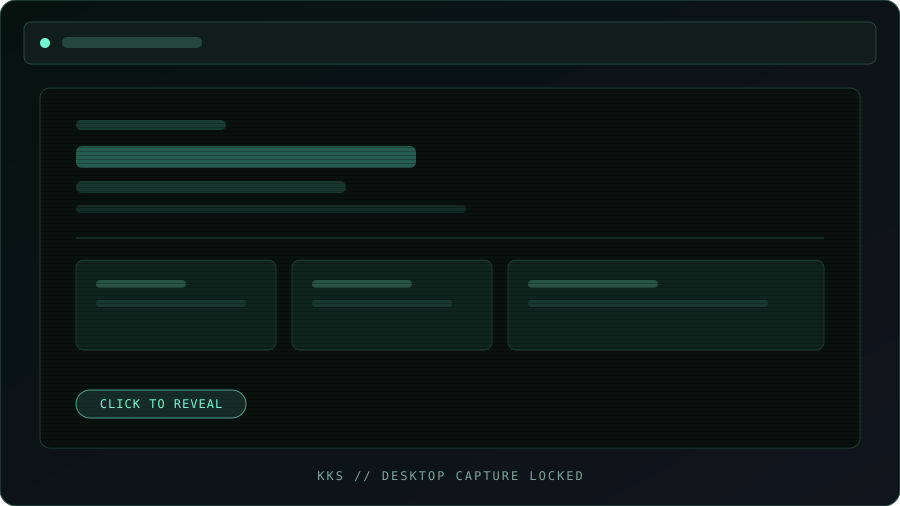
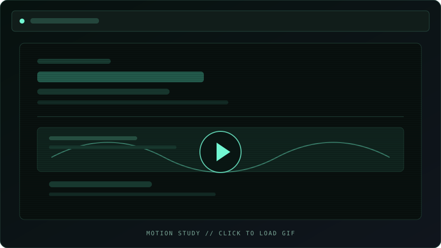

<!-- KKS SYSTEMS // SIGNAL OVER NOISE -->

# KKS / TERMINAL SHADER HERO

### NOT JUST A HERO SECTION. A LIVE SIGNAL.

A cyberpunk interface experiment built from **ASCII typography, real-time WebGL2 shaders, CRT artifacts, and reactive motion**.

 

<a href="https://kamyarahangar8778.github.io/kks-terminal-shader-hero/"><strong>↗ OPEN LIVE EXPERIENCE</strong></a>
&nbsp;&nbsp;·&nbsp;&nbsp;
<a href="#-boot-the-project">RUN LOCALLY</a>
&nbsp;&nbsp;·&nbsp;&nbsp;
<a href="https://github.com/KamyarAhangar8778/kks-terminal-shader-hero/issues">REPORT A BUG</a>

  

 

---

<pre>
┌──────────────────────────────────────────────────────────────────────┐
│  KKS.SYS  /  VISUAL SUBSYSTEM                              v0.1.0    │
├──────────────────────────────────────────────────────────────────────┤
│                                                                      │
│   ██╗  ██╗██╗  ██╗███████╗                                           │
│   ██║ ██╔╝██║ ██╔╝██╔════╝       ASCII FIELD .......... ACTIVE       │
│   █████╔╝ █████╔╝ ███████╗       SHADER PIPELINE ...... ONLINE       │
│   ██╔═██╗ ██╔═██╗ ╚════██║       CRT POST-PROCESS ..... ENABLED      │
│   ██║  ██╗██║  ██╗███████║       POINTER INPUT ........ LISTENING    │
│   ╚═╝  ╚═╝╚═╝  ╚═╝╚══════╝                                           │
│                                                                      │
│   [ SIGNAL ACQUIRED ]  [ REALTIME RENDERING ]  [ NO STATIC MOOD ]    │
└──────────────────────────────────────────────────────────────────────┘
</pre>

FIG. 01 — A terminal-inspired visual system, rendered in the browser.

## / 00 — Visual transmission

**LIVE CAPTURE / DESKTOP**

**MOTION STUDY / SMOOTH PAGE TOUR**

LIGHTWEIGHT PLACEHOLDERS / The full-resolution screenshot and animated GIF are requested only after you click a preview. GitHub README does not support custom CSS/JavaScript for an interactive Telegram-style skeleton, so these compact SVG placeholders provide the closest reliable native experience.

<a href="https://kamyarahangar8778.github.io/kks-terminal-shader-hero/"><strong>↗ OPEN THE LIVE EXPERIENCE</strong></a>

---

## / 00 — The concept

Most hero sections ask for attention. **This one generates its own atmosphere.**

KKS Terminal Shader Hero turns a portfolio landing page into an interactive visual instrument: a custom ASCII wordmark forms and bends through shader-driven motion, CRT treatments add analog texture, and pointer interactions send energy through the scene.

The result sits somewhere between a developer portfolio, a retro-futurist terminal, and a real-time graphics experiment.

## / 01 — The signal chain

<table>
<tr>
<td width="50%" valign="top">

**01. ASCII / WAVEFRONT**

A custom character field shapes the KKS wordmark with the *Wavefront ASCII Swirl* effect. Typography becomes part of the rendering system—not just text on top of a background.

</td>
<td width="50%" valign="top">

**02. SHADER / RESPONSE**

Harmonic waves and click-triggered shockwaves add a physical sense of response. Interactions are designed to feel deliberate, not like random movement layered over a page.

</td>
</tr>
<tr>
<td width="50%" valign="top">

**03. CRT / SIGNAL DAMAGE**

Scanlines, subtle curvature, flicker, and chromatic separation evoke phosphor displays and analog video artifacts without abandoning a clean modern layout.

</td>
<td width="50%" valign="top">

**04. MOTION / DEPTH**

Parallax, directional transitions, reveal effects, and a custom cursor create depth while the portfolio and contact content remain usable.

</td>
</tr>
<tr>
<td width="50%" valign="top">

**05. TYPE / ATLAS**

Custom font loading and browser-side caching support the character-atlas workflow used by the ASCII renderer.

</td>
<td width="50%" valign="top">

**06. TRANSMISSION / CONTACT**

A contact flow connects Telegram and EmailJS integrations, with a mailto fallback for an alternate route.

</td>
</tr>
</table>

## / 02 — Under the hood

| SYSTEM | IMPLEMENTATION |
|:--|:--|
| **Application** | Next.js 15 · App Router |
| **Interface** | React 19 · Strict TypeScript |
| **Styling** | Tailwind CSS 4 |
| **Animation** | Motion |
| **Rendering** | WebGL2 · Three.js · Canvas 2D |
| **Iconography** | Lucide · Tabler Icons |

### Rendering philosophy

<pre>
USER INPUT ──┬── POINTER / CLICK
             │
             ▼
       INTERACTION STATE
             │
             ▼
       WAVE + SHOCKWAVE ───────┐
                               ▼
CHARACTER FIELD ────────► WEBGL2 SHADER PASS
                               │
                               ▼
                      CRT / CHROMATIC LAYERS
                               │
                               ▼
                         LIVE EXPERIENCE
</pre>

<em>Conceptual flow of the visual system; the diagram describes the interaction/rendering idea, not a literal profiler trace.</em>

## / 03 — Boot the project

**Requirements:** Node.js 18.18+ and npm.

<pre><code>git clone https://github.com/KamyarAhangar8778/kks-terminal-shader-hero.git
cd kks-terminal-shader-hero
npm install
npm run dev</code></pre>

Open [http://localhost:3000](http://localhost:3000) and let the signal load.

<strong>Production build</strong>

<pre><code>npm run build
npm run start</code></pre>

<strong>Code quality commands</strong>

<pre><code>npm run lint
npm run typecheck
npm run format:check</code></pre>

Note: `npm test` is currently a placeholder script, not an automated test suite.

## / 04 — Field notes: performance, resilience & accessibility

The visual layer is the star—but a real-time effect should remain responsive, diagnosable, and usable across different devices. These are engineering principles and verification targets, not claims that every item has already been implemented.

<strong>GPU budget / keep every frame intentional</strong>

- Treat the number of rendered pixels as a major cost. A full-screen fragment shader can become expensive on high-DPI displays.
- Consider a capped device-pixel ratio or a smaller internal render target on slower devices, then upscale when the visual trade-off is acceptable.
- Reuse stable GPU resources instead of repeatedly recreating buffers, textures, framebuffers, or shader programs.
- Keep shader work proportional to the visual payoff; profile before adding more post-processing passes.
- Avoid synchronous GPU queries in the hot render loop, and investigate WebGL console errors rather than ignoring them.

Reference: [MDN — WebGL best practices](https://developer.mozilla.org/en-US/docs/Web/API/WebGL_API/WebGL_best_practices)

<strong>Graceful degradation / never strand the visitor</strong>

- Verify behavior when WebGL2 context creation fails or the browser loses its graphics context.
- Provide a readable static background or fallback presentation if the shader cannot initialize.
- Check asset-loading failures and shader compile/link logs during development.
- Test on an integrated GPU and a mobile device—not only on a high-end desktop.

Reference: [MDN — WebGL API](https://developer.mozilla.org/en-US/docs/Web/API/WebGL_API)

<strong>Accessibility / motion with an escape hatch</strong>

- Respect the operating system's reduced-motion preference for nonessential animation.
- Make sure navigation, portfolio links, and contact actions remain usable without hover effects or a custom cursor.
- Check contrast and text readability over the animated background.
- Ensure keyboard focus is visible and interactive elements have meaningful accessible names.
- Test touch interactions separately from mouse and trackpad input.

References: [MDN — prefers-reduced-motion](https://developer.mozilla.org/en-US/docs/Web/CSS/@media/prefers-reduced-motion), [W3C — WCAG 2.2](https://www.w3.org/TR/WCAG22/)

<strong>Static deployment / know the hosting contract</strong>

Next.js static export can produce HTML, CSS, and JavaScript assets for static hosting. It does not support features that require a server, so deployment must match the app's actual feature set. For GitHub Pages, verify the repository base path, asset URLs, trailing-slash behavior, and the final deployed routes.

References: [Next.js — Static Exports](https://nextjs.org/docs/app/guides/static-exports), [GitHub Pages documentation](https://docs.github.com/en/pages)

## / 05 — Source map

<pre>
app/
  globals.css              Global visual language
  layout.tsx               Metadata, fonts, root layout
  page.tsx                 Main experience composition

components/
  ascii-wordmark/          ASCII KKS rendering
  hero/                    WebGL canvas, CRT and glitch layers
  portfolio/               Project showcase
  contact/                 Contact and transmission flow
  custom-cursor/           Custom pointer treatment
  layout/                  Footer and shared layout

hooks/                     Interaction and animation logic
lib/                       Wave math, contact helpers, utilities
types/                     Shared TypeScript contracts
</pre>

## / 06 — Pre-flight checklist

Before calling the experience production-ready:

- [ ] Configure and verify Telegram and EmailJS contact integrations.
- [ ] Test WebGL2 support, frame pacing, and reduced-motion behavior on target devices.
- [ ] Check mobile layouts and touch interactions; custom cursors are pointer-oriented.
- [ ] Verify a graceful fallback if WebGL2 is unavailable or the context is lost.
- [ ] Run a production build and test the deployed base path.
- [ ] Confirm all social links and contact routes point to the intended destinations.
- [ ] Check keyboard navigation, visible focus, and text contrast over animated layers.
- [x] Add an automated workflow to capture a real screenshot and animated page tour from the deployed site.

## / 07 — Project links

| CHANNEL | DESTINATION |
|:--|:--|
| **LIVE** | [Open the deployed experience ↗](https://kamyarahangar8778.github.io/kks-terminal-shader-hero/) |
| **SOURCE** | [Browse the repository ↗](https://github.com/KamyarAhangar8778/kks-terminal-shader-hero) |
| **ISSUES** | [Report a problem ↗](https://github.com/KamyarAhangar8778/kks-terminal-shader-hero/issues) |
| **MAINTAINER** | [KKS Systems ↗](https://github.com/KamyarAhangar8778) |

## / 08 — License

Distributed under the [MIT License](LICENSE).

---

### KKS SYSTEMS

**LESS UI NOISE. MORE SIGNAL.**

END OF TRANSMISSION // THANK YOU FOR VISITING.

 

<a href="#kks-terminal-shader-hero">[ BACK TO TOP ↑ ]</a>

